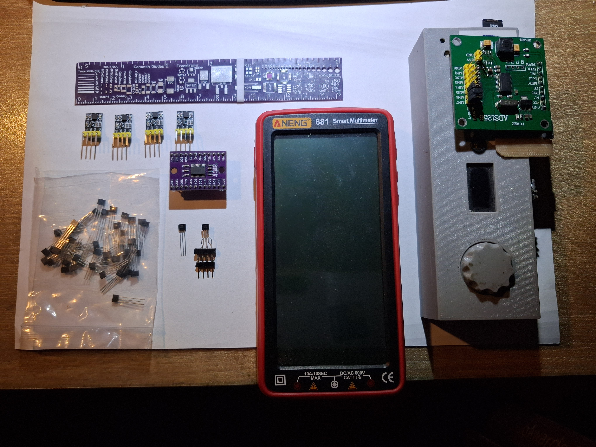
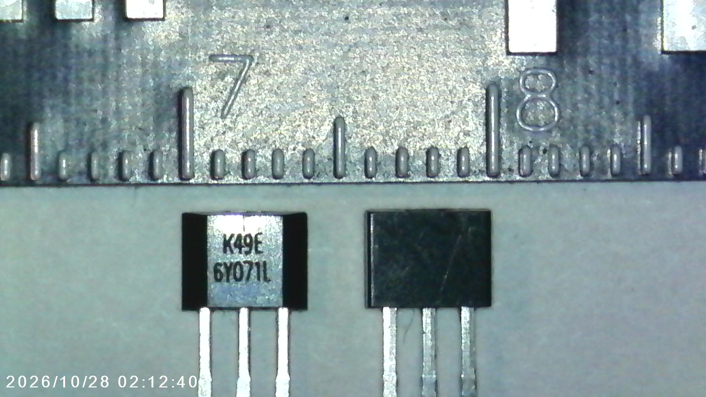
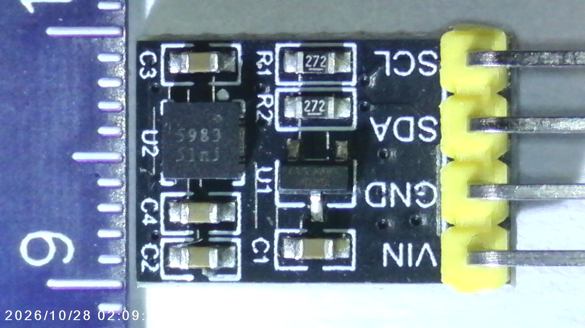
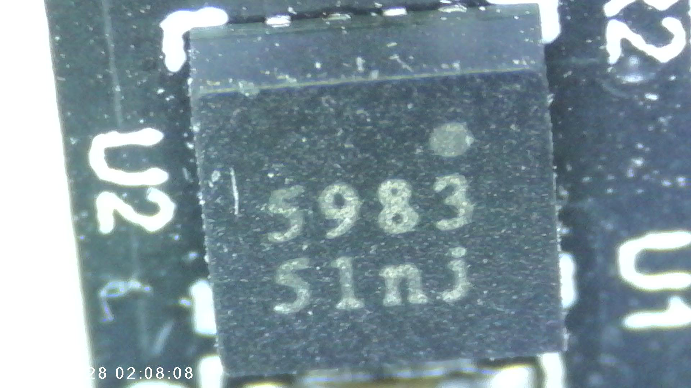
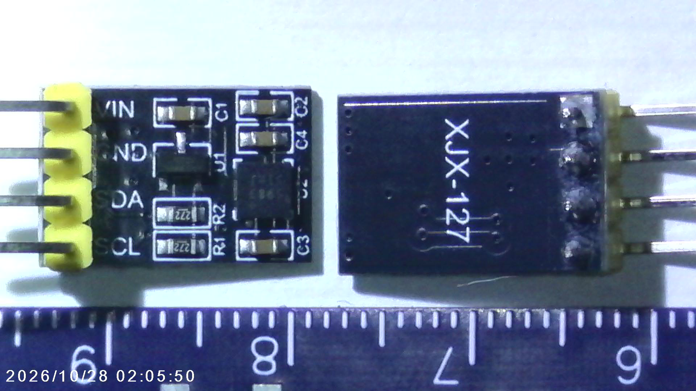
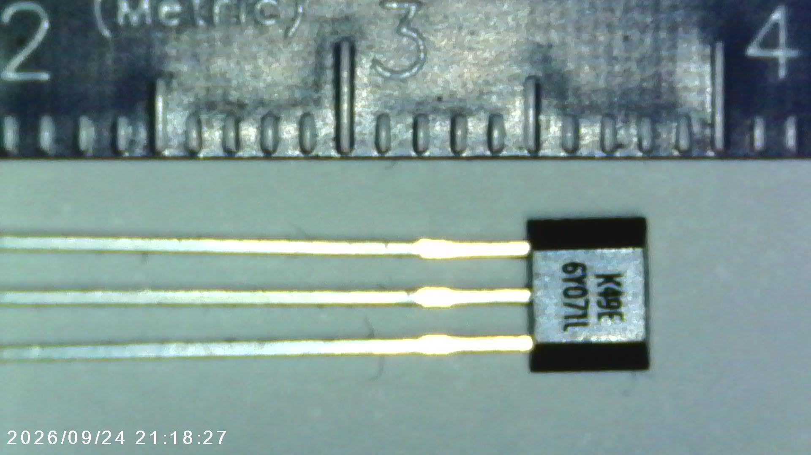

# Fotodokumentácia vybavenia

Fotografie poskytol používateľ 2026-10-28. Identifikácia podľa potlače nie je overením parametrov ani pinoutu.

## Prehľad vybavenia

Pôvodný názov: `20261028_014304.jpg`. Súbor je uložený bez úprav a zmenšenia.

Viditeľné sú trojvývodové senzory, štyri malé moduly, modul označený ADS1256, modul označený CD74HC4067 a multimeter ANENG 681. Zariadenie pod ADS1256 zatiaľ nie je identifikované.

## Detailné zábery

Všetky súbory boli skopírované bez úprav a zmenšenia; zhodnosť s originálmi bola overená pomocou SHA-256. Dátum v názve poznámky označuje evidenciu fotografií, nie nevyhnutne dátum ich zhotovenia.

### Dva senzory, na jednom čitateľné označenie K49E

Pôvodný názov: `IMG_070.JPG`.

### Modul a vývody VIN, GND, SDA, SCL

Pôvodný názov: `IMG_069.JPG`.

### Detail čipu s čiastočne čitateľným označením 983

Pôvodný názov: `IMG_068.JPG`.

### Predná a zadná strana modulov XJX-127

Pôvodný názov: `IMG_067.JPG`.

### Detail senzora s označením K49E

Pôvodný názov: `IMG_064.JPG`.

## Stav identifikácie

Výrobca a pinout K49E nie sú potvrdené. Presný typ čipu na moduloch XJX-127 nie je potvrdený. Fotografie zachytávajú označenia; nepredstavujú overenie parametrov komponentov.
